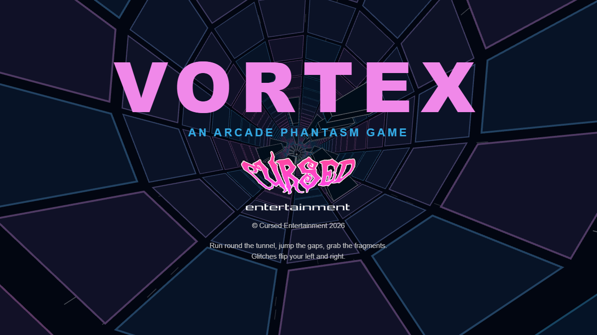
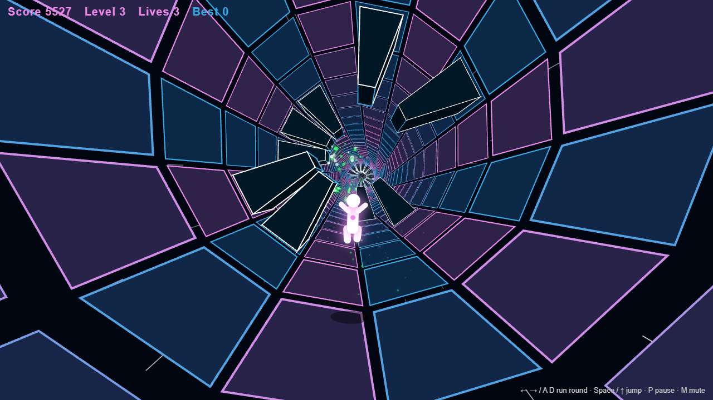
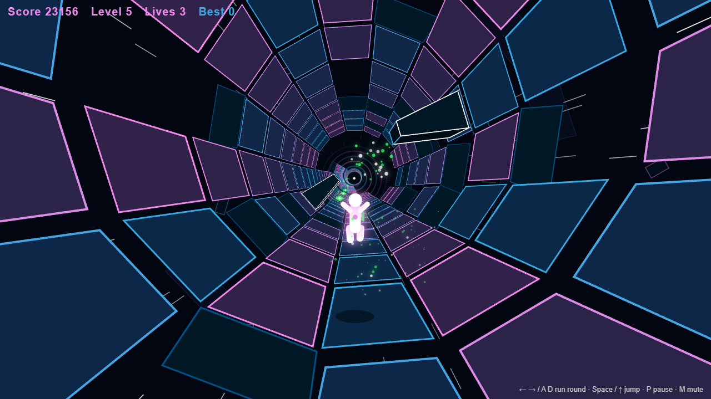
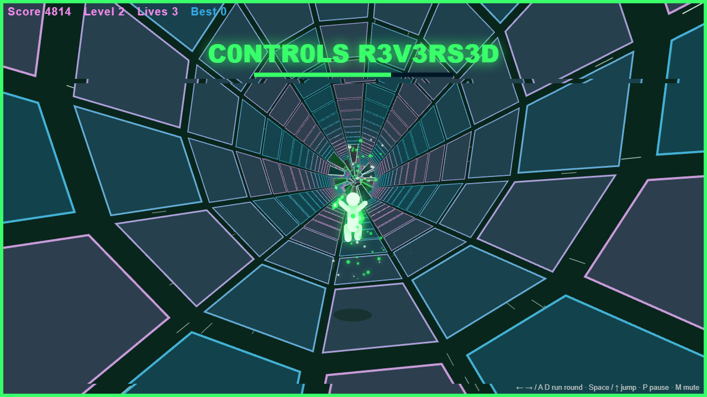

 

  

 

  
  
  

 

# VORTEX

**An [Arcade Phantasm](https://arcade-phantasm.netlify.app/) game** · **[Play it](https://cursedprograms.github.io/Vortex/)**

You're falling through a collapsing dimension. Run along the inside of a rotating tunnel, dodge obstacles and collect energy fragments while the tunnel twists, turns and finally breaks apart. Faster every level.

**The twist:** the glitchy, flickering blocks reverse your left and right for a few seconds. The screen turns green and tears while they're reversed.

  
  
  
  

## Versions

| Version | Where | Status |
|---|---|---|
| Browser | this folder, the repo root · **[Play it](https://cursedprograms.github.io/Vortex/)** | Playable |
| Windows exe | `cpp/` | Coming |
| Android | `android/` · [APK](android/apk/) | Playable |

## How to play

You run on the inside wall of the tunnel, seen from behind. Steering runs you round the wall, so "down" keeps changing, and the tunnel turns by itself too, sliding the panels under your feet.

- **Blocks**: run round them; they're too tall to jump.
- **Gaps**: jump them. A missing panel drops you into the void.
- **Spinning bars**: time your run past them.
- **Glitch blocks** (flickering green and pink): touch one and your left and right swap for a few seconds.
- **Energy fragments** (green diamonds): grab them for points; a run of them scores more.

Every level is faster. Level 2 brings glitches and spinning bars, level 3 corkscrews, level 4 panels that crumble away as you reach them, and from level 5 the tunnel has broken into floating pieces you jump between. You have three lives, and an extra one every third level. Your best score is kept in the browser.

## Controls

| Key | Action |
|---|---|
| ← → or A D | Run round the tunnel |
| Space, ↑ or W | Jump |
| P or Esc | Pause |
| M | Mute |
| Space or Enter | Run again after game over |

On a phone: the ◀ ▶ buttons run round, JUMP jumps, II pauses.

## Android

The browser game in an Android app: it plays offline, full screen in landscape, with the sound on from the start
(Android 7.0 or newer).

- **Download**: the APK in [`android/apk/`](android/apk/). Copy it to the phone and open it (allow installs from
  unknown sources when asked).
- **Build it**: the Android SDK and JDK 17, then `android/build.bat` (or `build.ps1`, `build.sh`). It runs
  `gradlew assembleDebug` and leaves the APK in `android/apk/`. The game's web files are copied into the app at build
  time, so the browser game at the repo root stays the only copy.
- **The code**: `android/app/src/main/java/com/synthwomb/vortex/MainActivity.kt`, a full-screen WebView that serves the
  game from the app's assets. Press Back twice to leave.

## Files

- `index.html`: the page
- `site/style.css`: the page's look
- `site/game.js`: the game: the tunnel, the track, the runner, the drawing
- `site/sfx.js`: the sound, made with Web Audio (no audio files)
- `images/`: the Cursed logo and the screenshots

Open `index.html#shot` for a mid-game screenshot (`#shot-broken` and `#shot-reversed` for the others).

## Also in the arcade

[KillerStardust](https://github.com/CursedPrograms/KillerStardust) · ProtocolHex · Seance · RicochetReaper · GraveDanger · **Vortex** · [Orbit](https://github.com/CursedPrograms/Orbit) · RocksOfRuin · Devourer

 

© Cursed Entertainment 2026

 

